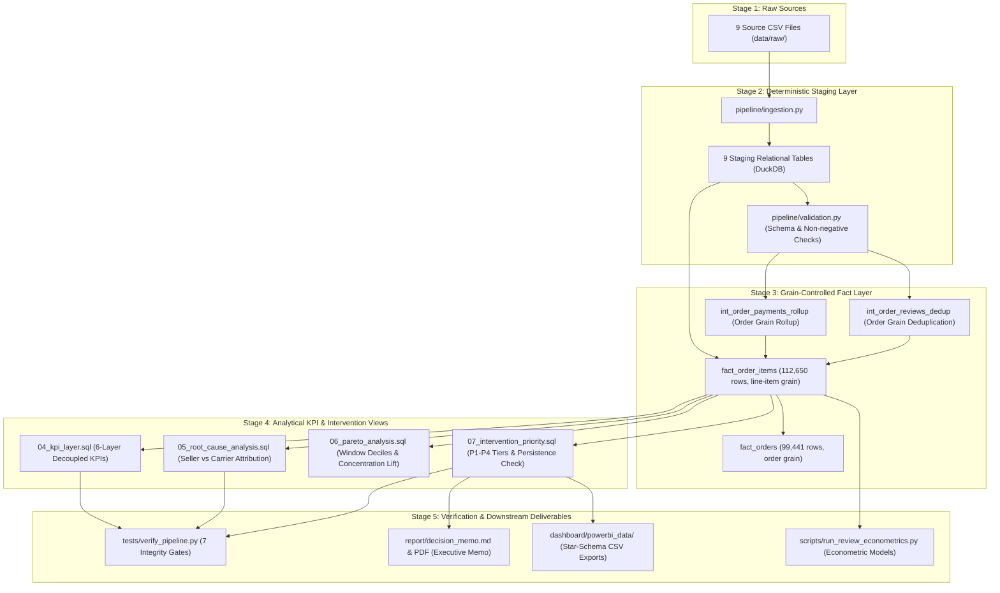

# 02: System Architecture & Data Lineage

**Project:** Marketplace Profitability & Fulfillment Leakage Analysis  
**Author:** Jenish Patel  
**Purpose:** Comprehensive guide to data flow, component responsibilities, and entity grain transformation.

---

## 1. End-to-End Data Flow Architecture

The data pipeline transitions raw commercial records through four progressive stages of abstraction: deterministic staging, grain-controlled fact modeling, multi-layer analytical views, and downstream presentation artifacts.

---

## 2. Component Responsibility Matrix

| Component | Responsibility | Inputs | Outputs | Primary Files |
|---|---|---|---|---|
| **Pipeline Configuration** | Declarative mapping of source files, target staging tables, validation constraints, and script execution order. | `pipeline/config.yaml` | Dict-based configuration passed to pipeline runners. | [`pipeline/config.yaml`](../../pipeline/config.yaml) |
| **Ingestion Engine** | Idempotent, deterministic ingestion of raw CSVs into DuckDB with explicit schema creation. | Raw CSVs in `data/raw/` | 9 DuckDB staging tables | [`pipeline/ingestion.py`](../../pipeline/ingestion.py) |
| **Validation Gate** | Pre-ingestion file presence/byte checks; post-ingestion schema presence, PK nullity, non-negative amounts, and timestamp parseability. | Staging DuckDB tables | Validation booleans; raises `ValueError` on breach. | [`pipeline/validation.py`](../../pipeline/validation.py) |
| **Fact Modeling Layer** | Grain-controlled dimension and fact transformation with pre-aggregation of payments and reviews to prevent fan-out duplication. | 9 Staging tables | `fact_order_items`, `fact_orders` | [`sql/01_schema.sql`](../../sql/01_schema.sql), [`sql/03_order_item_fact.sql`](../../sql/03_order_item_fact.sql) |
| **KPI & Root-Cause Layer** | 6-layer operational KPI aggregations, corridor latency analysis, and seller vs carrier handover attribution. | `fact_order_items`, `fact_orders` | DuckDB analytical views (`view_macro_kpi_monthly`, `view_root_cause_seller_carrier`, etc.) | [`sql/04_kpi_layer.sql`](../../sql/04_kpi_layer.sql), [`sql/05_root_cause_analysis.sql`](../../sql/05_root_cause_analysis.sql) |
| **Pareto & Prioritization Layer** | Windowed cumulative exposure distribution, concentration lift calculation, P1–P4 intervention tiering, and 2017→2018 holdout check. | `fact_order_items` | `view_pareto_seller_deciles`, `view_intervention_priority_sellers`, `view_seller_persistence_check` | [`sql/06_pareto_analysis.sql`](../../sql/06_pareto_analysis.sql), [`sql/07_intervention_priority.sql`](../../sql/07_intervention_priority.sql) |
| **Econometric Modeling** | Non-parametric rank tests (Kruskal-Wallis, Mann-Whitney), logistic regression with `seller_id` cluster-robust standard errors, and review-timing information set models. | `fact_order_items`, reviews staging | Statistical test statistics ($H, U, r$), regression tables, odds ratios | [`scripts/run_review_econometrics.py`](../../scripts/run_review_econometrics.py) |
| **Master Orchestrator** | Master CLI orchestrator executing pipeline, verification gate, documentation drift check, and test suite in sequence. | Command line invocation | Clean terminal status output, exit code 0/1 | [`scripts/run_all.py`](../../scripts/run_all.py) |

---

## 3. The Life of a Commercial Record: From Raw CSV to Intervention Tier

To see how raw data transforms into an executive decision, trace the lifecycle of a single customer transaction: **Order `001e7ad0e1a02b3eb0f22c9833824d2b`**.

### Step 1: Raw CSV Ingestion
- The order arrives as raw lines across four independent CSV files:
  - `olist_orders_dataset.csv`: `order_id = 001e7ad...`, `customer_id = c97b379...`, `order_status = 'delivered'`, `purchase_timestamp = 2018-08-07 11:15:45`, `delivered_customer_date = 2018-08-14 15:30:00`, `estimated_delivery_date = 2018-08-14 00:00:00`.
  - `olist_order_items_dataset.csv`: Item 1 of 1, `price = 39.90`, `freight_value = 17.66`, `seller_id = d8b39...`, `shipping_limit_date = 2018-08-13 11:25:00`.
  - `olist_order_payments_dataset.csv`: 1 credit card payment record of R\$ 57.56.
  - `olist_order_reviews_dataset.csv`: 1 review record submitted 2018-08-15 with `score = 5`.

### Step 2: Staging & Validation
- `pipeline/ingestion.py` executes `CREATE OR REPLACE TABLE olist_orders AS SELECT * FROM read_csv_auto(...)`.
- `pipeline/validation.py` verifies that `order_id` is non-null, `price >= 0`, `freight_value >= 0`, and timestamps parse properly without exception.

### Step 3: Grain Isolation & Handover Attribution in `fact_order_items`
- The query evaluates:
  1. **Date-Level Lateness Comparison:**
     - Delivered date: `2018-08-14`
     - Estimated date: `2018-08-14`
     - Logic: `CAST('2018-08-14 15:30:00' AS DATE) > CAST('2018-08-14 00:00:00' AS DATE) = FALSE`.
     - Result: `is_late = 0` (On-time!). *Note: A naive timestamp comparison would have erroneously marked this as late because 15:30 > 00:00.*
  2. **Handover Gate SLA:**
     - Carrier handover timestamp: `2018-08-08 14:10:00`
     - Shipping limit date: `2018-08-13 11:25:00`
     - Seller dispatch was on-time (`is_seller_late_dispatch = 0`).
  3. **Financial Grain Check:**
     - Payments and reviews are joined via 1-to-1 aggregated CTEs (`int_order_payments_rollup`), ensuring item count remains exactly 1 without row duplication.

### Step 4: Analytical Aggregation in KPI & Prioritization Views
- If another item from this seller had been late (`is_late = 1`):
  - In `sql/05_root_cause_analysis.sql`, if the seller dispatched late, the value is attributed to `is_seller_caused_late`; if the seller dispatched on-time, it is attributed to `is_carrier_caused_late`.
  - In `sql/07_intervention_priority.sql`, seller `d8b39...` accumulates total lifetime order volume ($N$) and seller-caused late exposure.
  - If $N \ge 30$, seller-caused exposure exceeds the 75th percentile, and late rate exceeds the 75th percentile, the merchant is assigned to **`P1 — Immediate Intervention`**.
  - Under `view_intervention_tier_summary`, the merchant's late exposure is aggregated into platform P1 exposure (R\$ 181,377.55), feeding the 25% illustrative mitigation model (R\$ 45,344.39).

### Step 5: Executive Delivery & Dashboard Refresh
- `scripts/render_readme_tables.py` reads the view output directly from DuckDB and dynamically injects the updated numbers into `README.md` and `report/decision_memo.md`.
- `dashboard/generate_powerbi_data.py` exports the row into `dashboard/powerbi_data/fact_order_items.csv` for star-schema reporting.
