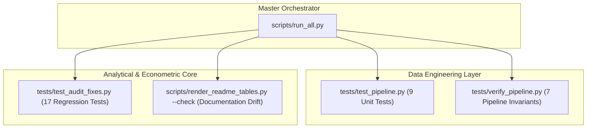

# 07: Testing Strategy, Suite Coverage & Extensibility

**Project:** Marketplace Profitability & Fulfillment Leakage Analysis  
**Author:** Jenish Patel  
**Purpose:** Comprehensive guide to automated test architecture, coverage breakdown, intentional gaps, and instructions for adding tests.

---

## 1. Testing Philosophy & Architecture

This repository adopts an **assertion-driven testing architecture** designed to prevent regression, detect schema drift, and verify mathematical invariants across every level of the pipeline:



---

## 2. Test Suite Coverage by Module

### 1. Pipeline Verification Invariants (`tests/verify_pipeline.py`)
Executed after every pipeline run. Asserts 7 immutable structural and business invariants against DuckDB:
1. `fact_orders` Primary Key Uniqueness: Asserts zero duplicate `order_id` values.
2. `fact_order_items` Composite Key Uniqueness: Asserts zero duplicate `(order_id, order_item_id)` pairs across 112,650 items.
3. Total Platform GMV Reconciliation: Asserts that $\sum \text{price}$ in `fact_order_items` equals exactly R\$ 13,591,643.70 (source truth).
4. Total Platform Freight Reconciliation: Asserts that $\sum \text{freight\_value}$ in `fact_order_items` equals exactly R\$ 2,251,909.54.
5. Delivered Order Rate Bounds: Asserts delivered rate is bounded in $[0, 100\%]$ and equals 97.02% (96,478 / 99,441).
6. Cancellation Rate Bounds: Asserts cancellation rate is bounded in $[0, 100\%]$ and equals 0.63% (625 / 99,441).
7. Late Delivery Rate Bounds: Asserts late rate is non-negative and bounded within realistic bounds (equals 6.77%).

### 2. Data Engineering Unit Tests (`tests/test_pipeline.py`)
Tests defensive data engineering primitives:
- `test_config_loading`: Confirms `config.yaml` loads with all required keys and schema definitions.
- `test_source_validation_missing_file`: Asserts fail-fast `ValueError` when a mandatory raw CSV is missing.
- `test_source_validation_empty_file`: Asserts fail-fast `ValueError` when a CSV has 0 bytes.
- `test_staging_validation_missing_table`: Confirms validator catches missing DuckDB tables.
- `test_staging_validation_missing_column`: Confirms validator catches dropped columns.
- `test_staging_validation_null_pk`: Asserts error on NULL primary key values.
- `test_staging_validation_negative_values`: Asserts error if price or freight is negative.
- `test_staging_validation_invalid_timestamp`: Confirms parameterized timestamp parseability detection.
- `test_pipeline_idempotency_dual_run`: Executes two complete pipeline runs sequentially and asserts exact row-count and financial invariant equality.

### 3. Audit Fixes & Statistical Regression Tests (`tests/test_audit_fixes.py`)
Verifies statistical methodologies and prevents recurrence of resolved audit defects:
- `test_p01_same_day_delivery_not_late`: Verifies calendar date casting prevents 1,292 same-day on-time deliveries from being marked late.
- `test_p02_seller_vs_carrier_attribution`: Confirms 72.25% of late orders were handed over to carriers on time.
- `test_p03_reviews_before_delivery`: Confirms 70.10% of late orders were reviewed prior to customer delivery.
- `test_p04_three_level_exposure_framework`: Verifies Level 1, Level 2, and Level 3 exposure metrics reconcile to DuckDB views.
- `test_p15_econometric_discrepancies`: Verifies non-negative delay formulation and exact DuckDB test statistics.
- `test_p16_pareto_concentration_lift`: Asserts Decile 1 accounts for 60.78% GMV, 77.38% late exposure, and 1.27× lift.
- `test_p17_temporal_persistence_split`: Validates the 2017 $\to$ 2018 holdout: the 2017 P1 cohort still has a positive seller-caused gap in 2018, and the gap is smaller than in 2017.
- `test_mp06_persistence_cohort_uses_headline_tier_rule`: Asserts the tier rule exists once in SQL, the headline matrix and the 2017 cohort both read it, and the whole-dataset period reproduces the headline tiers.
- `test_mp06_persistence_bootstrap_is_reproducible`: Asserts the seller-level bootstrap uses at least 2,000 resamples, is deterministic, and brackets its point estimates.
- `test_mp06_no_unsupported_persistence_claims`: Fails if public docs use the retired persistence wording or quote the retired baseline figure.
- `test_mp09_post_handover_view_ties_to_headline_attribution`: Asserts `view_post_handover_pairs` reproduces the headline split of late (order, seller) pairs (4,730 post-handover, 72.25% of 6,547) against an independent query.
- `test_mp09_transit_dominates_promise_on_same_corridor`: Asserts that on every tested corridor (including SP $\to$ SP and SP $\to$ RJ) late post-handover pairs have a transit gap more than three times their promise gap, that the bootstrap is deterministic with at least 2,000 resamples, and that every interval brackets its estimate.
- `test_mp09_post_handover_blocks_rendered`: Asserts the transit-vs-promise table (guide 09) and its summary (README, memo) equal the freshly rendered text.
- `test_mp09_no_carrier_attribution_wording`: Fails if public docs use the retired carrier-attribution wording.
- `test_p18_tier_naming_and_documentation`: Asserts P4 is labeled "P4 - Low Volume / Not Prioritised".
- `test_open_lead1_unfulfilled_orders_breakdown`: Quantifies 2,963 unfulfilled orders.
- `test_mp01_clustering_variable_and_sensitivities`: Asserts econometrics script clusters primarily on `seller_id` (2,953 clusters) and includes `seller_state` and `HC1` sensitivities.
- `test_mp02_honest_money_framing`: Purges forbidden phrases across codebase.
- `test_mp03_persistence_result_rendered`: Confirms holdout persistence table is rendered into documentation.
- `test_mp04_snapshot_formatting`: Confirms currency formatting for `base_mitigation_25pct` (R\$ 45,344.39).
- `test_mp05_reproducible_environment`: Confirms pinned `requirements.txt` and `scripts/run_all.py` exist.
- `test_readme_tables_match_database`: Confirms live table sync check passes with zero diff.
- `test_d1_guide_files_00_to_04`: Confirms public guide files 00 to 04 exist with required mathematical concepts.
- `test_d2_guide_files_05_to_09_and_glossary`: Confirms public guide files 05 to 09 and glossary exist with required content.

---

## 3. Intentional Testing Gaps

To maintain engineering discipline, we intentionally do not write tests for:
1. **Unobserved Financial Overhead:** We do not test simulated marketplace net profit margins or payment gateway cost models, because the public dataset lacks actual platform balance sheet data.
2. **Heavy Distributed Frameworks:** We do not test Spark, Airflow, or Kafka integrations. The dataset fits in memory; DuckDB executes all queries in $<2$ seconds without cluster orchestration overhead.
3. **Power BI GUI Rendering:** We do not test Power BI desktop visual rendering. Automated tests validate the underlying star-schema dimensional CSV exports (`dashboard/powerbi_data/`).

---

## 4. Fresh-Clone Behavior & Auto-Fallback

When a new user or continuous integration server clones the repository, the database file `marketplace.duckdb` is not present (it is git-ignored).

To prevent test crashes on fresh clones:
- `scripts/render_readme_tables.py` and `scripts/run_review_econometrics.py` contain an automatic fallback:
  ```python
  def get_db_connection(db_path):
      if os.path.exists(db_path):
          return duckdb.connect(db_path, read_only=True)
      # In-memory fallback: builds staging directly from CSVs
      con = duckdb.connect(":memory:")
      # Loads tables via read_csv_auto ...
      return con
  ```
This guarantees that fresh-clone verification tests pass immediately without requiring manual database initialization.

---

## 5. How to Add a New Test

To add a new unit or regression test:

### Step 1: Open `tests/test_audit_fixes.py`
Add a new test method to `TestAuditFixes`:
```python
def test_new_business_invariant(self):
    """Verify that multi-seller orders account for exactly 1,278 distinct orders."""
    res = self.con.execute(
        "SELECT COUNT(DISTINCT order_id) FROM fact_orders WHERE is_multi_seller = 1"
    ).fetchone()[0]
    self.assertEqual(res, 1278, f"Expected 1,278 multi-seller orders, got {res}")
```

### Step 2: Run Pytest
```powershell
python -m pytest tests/test_audit_fixes.py -k test_new_business_invariant
```

### Step 3: Verify End-to-End Suite
```powershell
python scripts/run_all.py
```
Assert that all verification stages exit green with code 0.
